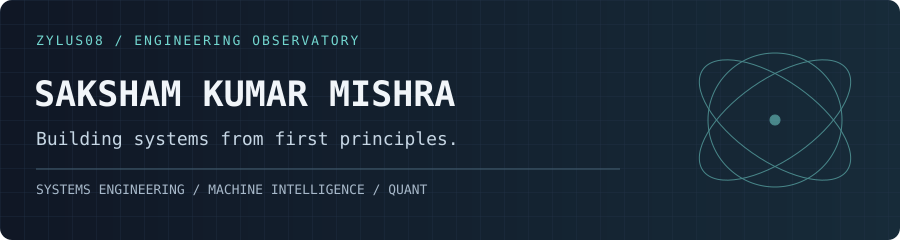

<a href="https://sakshamkumarmishra.cv">Portfolio</a> · <a href="https://github.com/Zylus08?tab=repositories">Repositories</a>

## 01 / Research & engineering

Computer engineering undergraduate exploring the intersection of machine intelligence, systems engineering and quantitative research. I enjoy building the underlying machinery: query engines, interpreters, neural runtimes and experimental learning systems.

## 02 / Systems, from scratch

| Project | Engineering focus |
| :--- | :--- |
| [AXIOM](https://github.com/Zylus08/Axiom) | SQL query execution engine |
| [PRAXIS](https://github.com/Zylus08/PRAXIS) | C++ interpreter exploration |
| [FORGE](https://github.com/Zylus08/FORGE) | CPU-oriented neural training acceleration |
| [VECTRA](https://github.com/Zylus08/VECTRA) | CPU language-model inference |
| [Fault-tolerant Compute Scheduler](https://github.com/Zylus08/Fault-tolerant-Compute-Scheduler) | Distributed compute infrastructure |

## 03 / Machine intelligence & scientific computing

| Project | Research direction |
| :--- | :--- |
| [NOMOS](https://github.com/Zylus08/NOMOS) | Learning physical laws from observations |
| [JANUS](https://github.com/Zylus08/Project-Janus) | Chess search and neural evaluation |
| [RoadVision](https://github.com/Zylus08/RoadVision) | Computer vision for road scenes |
| [Aerospace RUL](https://github.com/Zylus08/Rolls-Royce-Aerospace-RUL) | Predictive maintenance and remaining useful life |
| [Thermodynamic Evolution](https://github.com/Zylus08/Thermodynamic-Evolution-UCS503) | Automated software evolution |

## 04 / Quantitative laboratory

| Project | Focus |
| :--- | :--- |
| [Satoshi Flow](https://github.com/Zylus08/Satoshi_Flow) | Systematic cryptocurrency strategy research |
| [TradeCore](https://github.com/Zylus08/TradeCore) | Trading infrastructure |
| [Regime Shift](https://github.com/Zylus08/Regime-Shift) | Market regime modelling |
| [RiskLab](https://github.com/Zylus08/RiskLab) | Quantitative risk research |
| [DeepHedge-RL](https://github.com/Zylus08/DeepHedge-RL) | Reinforcement learning for hedging |
| [AQC](https://github.com/Zylus08/AQC) | Collaborative quantitative research |

## 05 / Working toolkit

**Languages** — Python · C++ · C · Rust · Go · TypeScript · SQL

**Machine learning** — PyTorch · TensorFlow · scikit-learn · reinforcement learning · time-series modelling

**Engineering** — FastAPI · React · Docker · GitHub Actions · CMake

## 06 / Repository telemetry

Public, non-fork, non-archived repositories only. Language distribution measures primary repository language, not proficiency. Automated refreshes do not represent original engineering contributions.

---

<i>Understand the abstraction. Then build what lies beneath it.</i>

