<!-- Generated by scripts/assemble_readme.py. Edit data/projects.json or the assembly source. -->

<picture>
  <source media="(max-width: 600px)" srcset="assets/hero/mobile.svg" />
  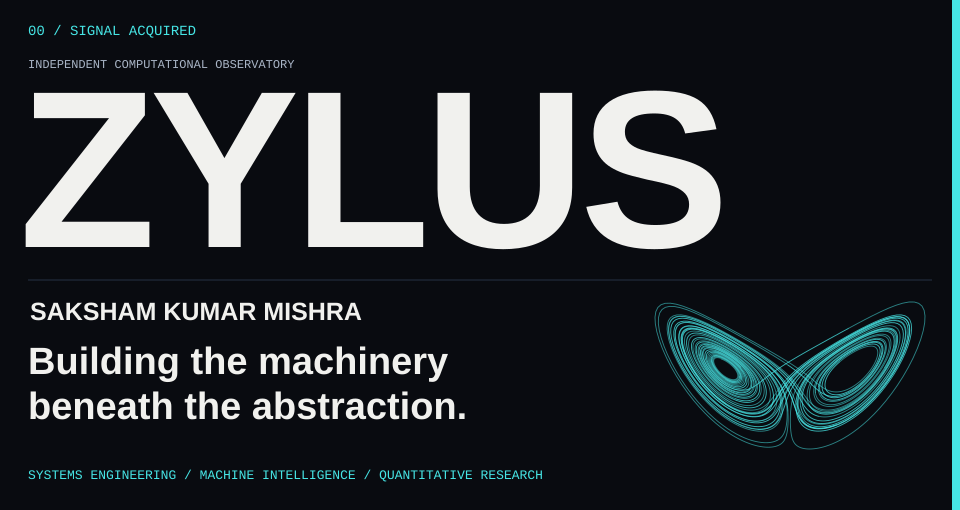
</picture>

<a href="https://sakshamkumarmishra.cv">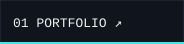</a>
<a href="https://github.com/Zylus08?tab=repositories">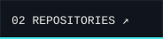</a>
<a href="https://www.linkedin.com/in/saksham-mishra-ml/">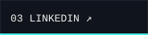</a>
<a href="https://sakshamkumarmishra.cv/documents/Saksham_Mishra_CV.pdf">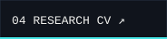</a>

## 01 / Operator profile

**I build systems to understand them.** Query engines, language runtimes, CPU learning systems—and experiments at the intersection of computation, physical laws and markets. I’m Saksham Kumar Mishra, a computer engineering undergraduate approaching engineering as inquiry.

[Systems](#02--systems-from-first-principles) · [Intelligence](#03--machine-intelligence) · [Quant](#04--quantitative-laboratory) · [Telemetry](#06--developer-telemetry)

## 02 / Systems from first principles

Four investigations into the machinery beneath familiar abstractions. Open a dossier to inspect the implementation, tests and limitations.

<a href="https://github.com/Zylus08/Axiom">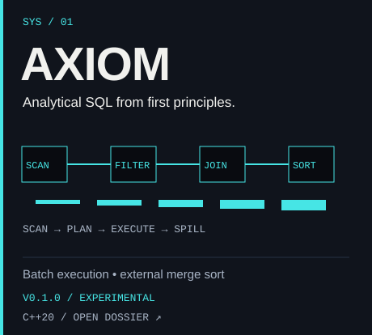</a>
<a href="https://github.com/Zylus08/PRAXIS">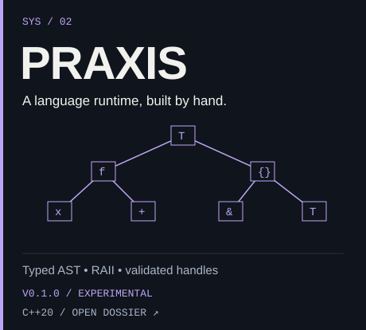</a>
<a href="https://github.com/Zylus08/FORGE">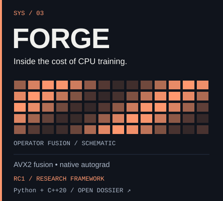</a>
<a href="https://github.com/Zylus08/VECTRA">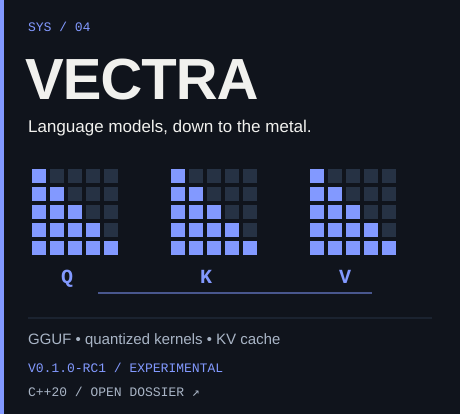</a>

**Boundaries matter.** AXIOM and PRAXIS implement deliberate language subsets. FORGE’s end-to-end acceleration target was **not achieved**. VECTRA’s sustained-throughput objective remains **partial**. Release labels describe repository milestones, not independent certification.

Also exploring [fault-tolerant compute scheduling](https://github.com/Zylus08/Fault-tolerant-Compute-Scheduler), with Raft and a distributed control plane.

## 03 / Machine intelligence

From observations to models—and from models back to questions. These are engineering experiments and research investigations; no peer-review status is implied.

<a href="https://github.com/Zylus08/NOMOS">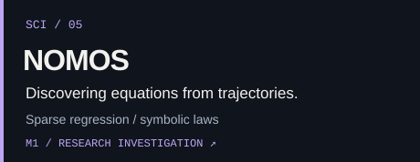</a>
<a href="https://github.com/Zylus08/Project-Janus">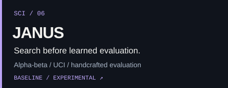</a>
<a href="https://github.com/Zylus08/RoadVision">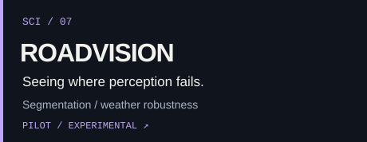</a>
<a href="https://github.com/Zylus08/Rolls-Royce-Aerospace-RUL">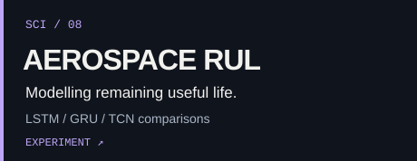</a>
<a href="https://github.com/Zylus08/Thermodynamic-Evolution-UCS503">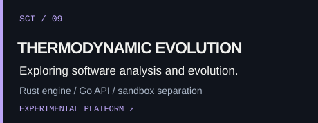</a>
<a href="https://github.com/Zylus08/Neural-Surrogate-Monte-Carlo-Collision-Simulator">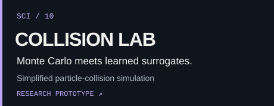</a>

JANUS’s default-branch baseline uses handcrafted evaluation. RoadVision reports a small pilot evaluation. Aerospace RUL is an independent project, with no implied Rolls-Royce affiliation.

## 04 / Quantitative laboratory

<picture>
  <source media="(max-width: 600px)" srcset="assets/research/quant-mobile.svg" />
  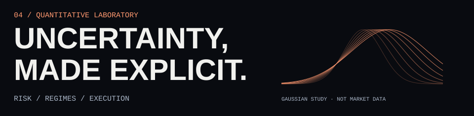
</picture>

<a href="https://github.com/Zylus08/Satoshi_Flow">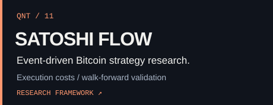</a>
<a href="https://github.com/Zylus08/TradeCore">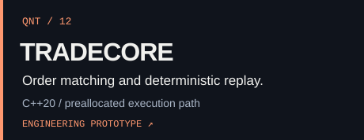</a>
<a href="https://github.com/Zylus08/Regime-Shift">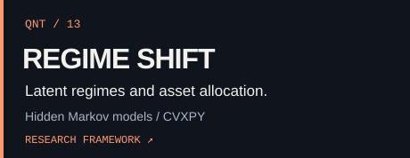</a>
<a href="https://github.com/Zylus08/RiskLab">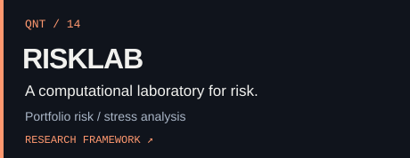</a>
<a href="https://github.com/Zylus08/DeepHedge-RL">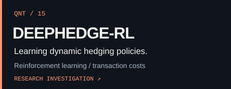</a>
<a href="https://github.com/Zylus08/AQC">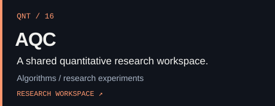</a>

Research infrastructure for asking better questions about risk and execution. No financial returns, live profitability or production trading readiness are claimed.

## 05 / Technology matrix

Tools represented in public project source and dependency manifests. A capability map, without proficiency scores.

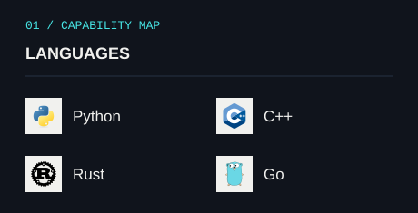
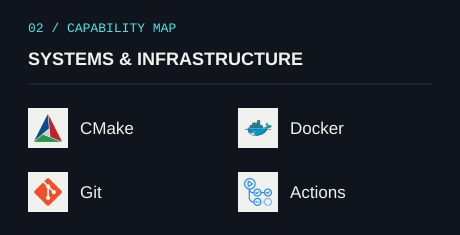
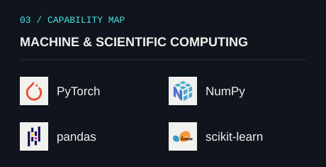
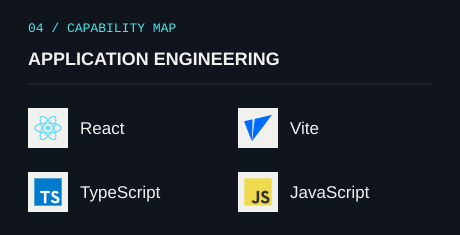

Numerical work also includes SciPy, Jupyter, time-series modelling and reinforcement learning. [Technology evidence and icon licenses](reports/04_PROJECT_EVIDENCE.md).

## 06 / Developer telemetry

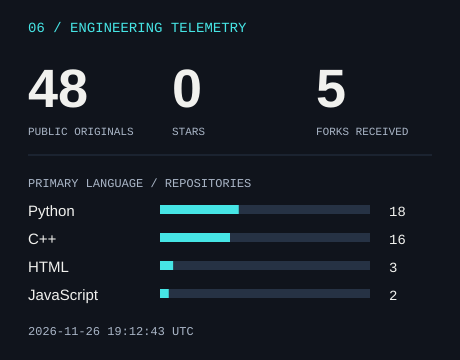
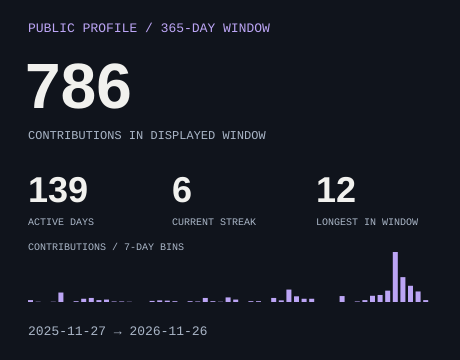

[Read the current snapshot and recent pushes](data/telemetry.md) · [How these metrics are measured](reports/06_TELEMETRY_AND_SKYLINE.md)

Repository metrics exclude forks, archives and this profile repository. Language bars count primary repository languages, **not proficiency**. Contribution totals reflect the public profile calendar, which can include anonymized private activity if enabled. Weekly refreshes preserve the last valid timestamped snapshot on failure.

## 07 / Activity topography

<picture>
  <source media="(max-width: 600px)" srcset="assets/skyline/mobile.svg" />
  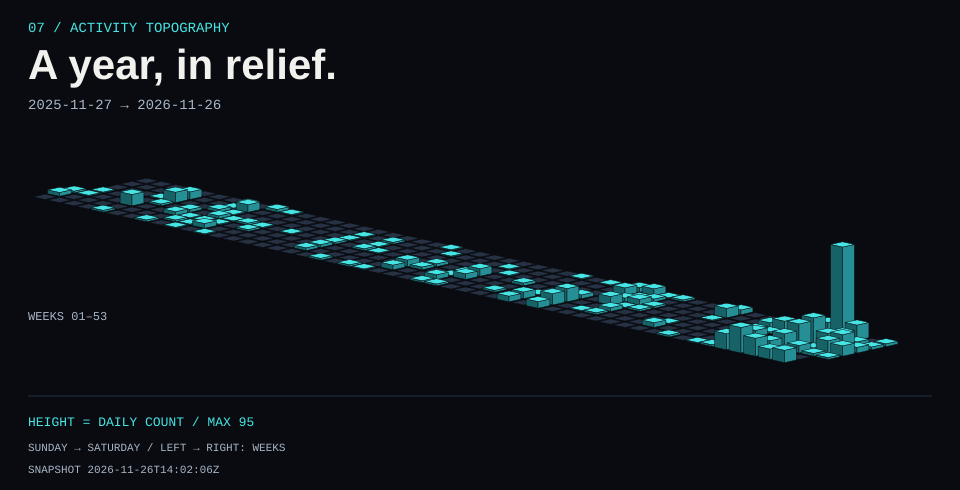
</picture>

[Calendar data and provenance](data/github_snapshot.json). The skyline includes every day in the displayed window, including zero-activity days.

## 08 / Computational frontiers

<picture>
  <source media="(max-width: 600px)" srcset="assets/research/frontiers-mobile.svg" />
  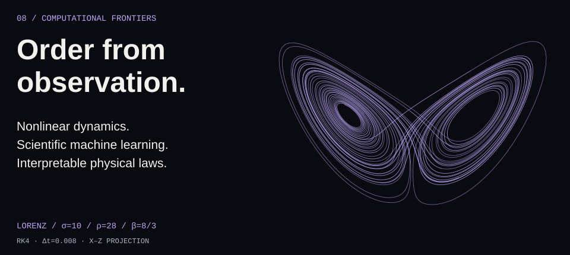
</picture>

**Questions I want to pursue:** How can machines recover physical laws from observations? What survives noise, changing regimes and nonlinear dynamics? How can computational systems expose their own limits?

These are research interests. The artwork integrates the Lorenz equations using RK4; [equations, parameters and reproduction](reports/05_ASSET_GENERATION.md).

## 09 / End of transmission

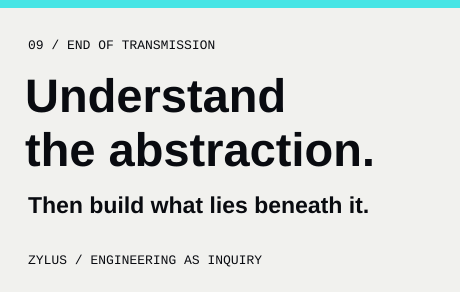

[Start a conversation](mailto:mishrasaksham080705@gmail.com) · [Explore the portfolio](https://sakshamkumarmishra.cv) · [Read the CV](https://sakshamkumarmishra.cv/documents/Saksham_Mishra_CV.pdf)

Original computational artwork. Public evidence. Reproducible assets. [Behind the observatory](reports/10_FINAL_RELEASE_REPORT.md).
